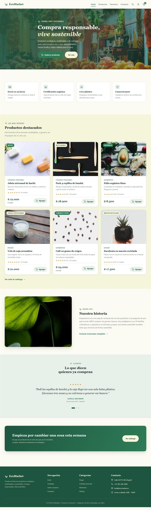
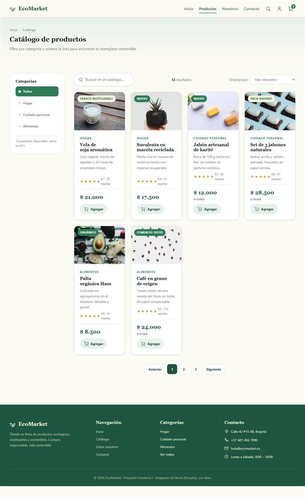
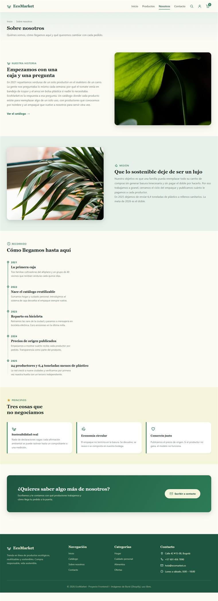
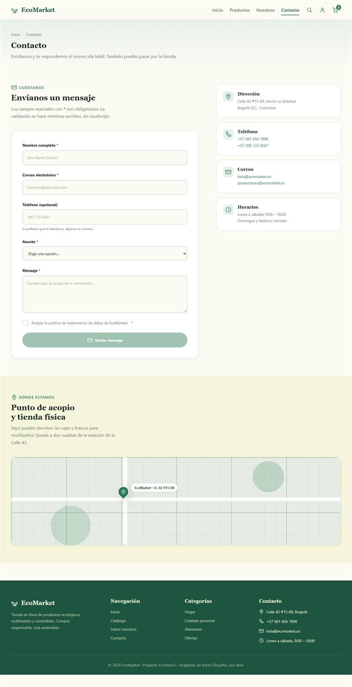
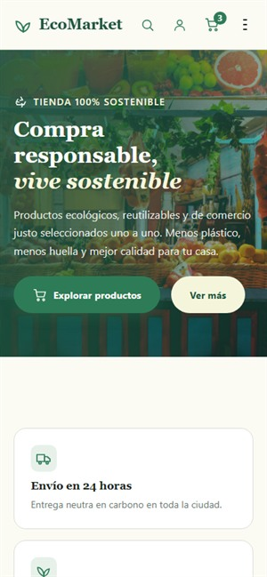
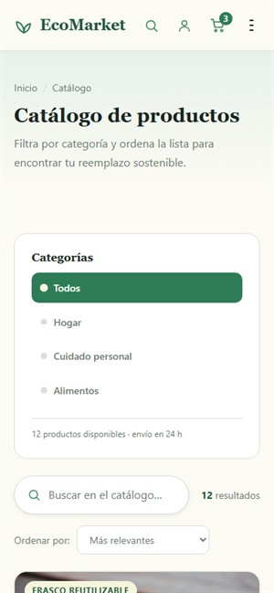
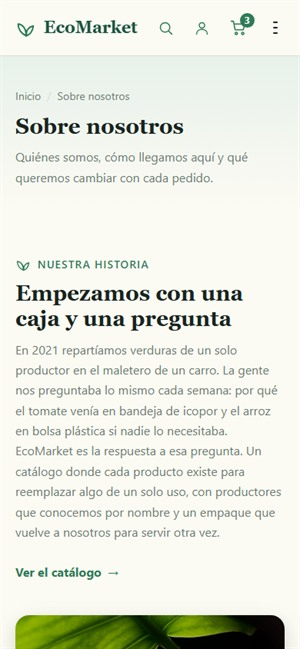
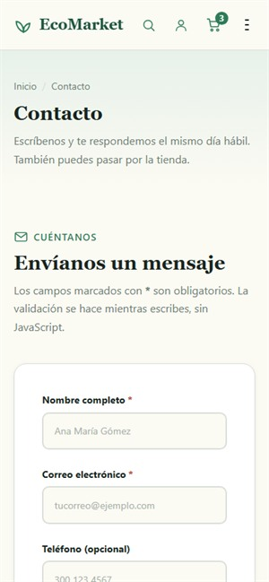

# 🌿 EcoMarket

Tienda en línea de productos ecológicos, reutilizables y sostenibles.
Proyecto 1 del curso **Frontend I**: maquetación de cuatro vistas con una
experiencia fluida, responsiva y fiel al diseño, usando **únicamente HTML5
semántico y CSS3 puro**.

> Sin JavaScript, sin frameworks y sin librerías externas de estilos.
> Toda la interactividad (menú móvil, filtros, paginación, carrusel de
> testimonios y validación del formulario) está resuelta con CSS.

---

## 📄 Índice

1. [Descripción del proyecto](#-descripción-del-proyecto)
2. [Tecnologías utilizadas](#-tecnologías-utilizadas)
3. [Instrucciones de visualización](#-instrucciones-de-visualización)
4. [Estructura de archivos](#-estructura-de-archivos)
5. [Interactividad resuelta solo con CSS](#-interactividad-resuelta-solo-con-css)
6. [Capturas de pantalla](#-capturas-de-pantalla)
7. [Responsividad](#-responsividad)
8. [Créditos](#-créditos)

---

## 🌱 Descripción del proyecto

EcoMarket es una tienda dedicada en exclusiva a productos ecológicos y
sostenibles. El objetivo del sitio es que cualquier usuario pueda explorar el
catálogo, conocer sus beneficios y realizar compras responsables, entendiendo
en pocos segundos por qué la tienda existe.

Este proyecto resuelve tres problemas habituales en este tipo de catálogos:

- **UX / UI limpia y coherente.** Paleta de dos colores base (verde y beige),
  tipografía clara y tarjetas con la misma estructura en las cuatro vistas.
- **Desarrollo responsivo.** Enfoque *mobile-first*: una columna en el móvil,
  dos en tablet, tres en escritorio y cuatro a partir de 1200 px.
- **Técnica sin dependencias.** Al no usar JavaScript, el comportamiento
  interactivo se construye con selectores `:hover`, `:focus`, `:checked`,
  `:valid`, `:target` y transiciones CSS.

### Vistas

| Vista | Archivo | Contenido |
|---|---|---|
| Inicio | `index.html` | Hero, beneficios, 6 productos destacados, historia, carrusel de testimonios y llamado a la acción |
| Catálogo | `views/productos.html` | Barra lateral de filtros, buscador, barra de ordenamiento, grilla de 12 productos y paginación |
| Sobre nosotros | `views/sobre-nosotros.html` | Brand story, misión, línea de tiempo y valores |
| Contacto | `views/contacto.html` | Formulario validado, datos de contacto y mapa |

---

## 🛠 Tecnologías utilizadas

| Tecnología | Uso en el proyecto |
|---|---|
| **HTML5 semántico** | Estructura de contenido con `header`, `nav`, `main`, `section`, `article`, `aside` y `footer` |
| **CSS3 puro** | Variables personalizadas, Grid, Flexbox, `clamp()`, pseudo-clases de estado y `@keyframes` |
| **SVG** | Doce iconos propios en `img/icons/`, coloreados y reutilizados con `background-image` y filtros |
| **Git y GitHub** | Control de versiones con flujo GitFlow y ramas `feature/*` |

Archivos CSS y su responsabilidad:

- `css/main.css` → reset, variables de diseño, tipografía, iconos y utilidades.
- `css/layout.css` → cabecera, pie de página, portada y sistemas de grilla.
- `css/components.css` → tarjetas, botones, campos de formulario, filtros, paginación, carrusel y mapa.
- `css/animations.css` → `@keyframes` y transiciones de entrada, hover y flotación.

---

## 👀 Instrucciones de visualización

### Opción 1: abrir en local

1. Descarga o clona este repositorio.

   ```bash
   git clone https://github.com/Juan-1522/EcoMarket_JuanAndresSuarez.git
   ```

2. Entra a la carpeta `EcoMarket_JuanAndresSuarez` y abre el archivo `index.html` con
   **doble clic** o arrástralo a una ventana del navegador.

3. Para ver las otras vistas, navega con el menú superior o abre
   directamente `views/productos.html`, `views/sobre-nosotros.html` y
   `views/contacto.html`.

> No necesita servidor, instalación ni conexión a internet: todas las
> imágenes están dentro del repositorio.

### Opción 2: sitio publicado

El proyecto está desplegado en **Netlify** y es de acceso público (no pide
contraseña):

🔗 **https://ecomarket-juansuarez.netlify.app**

| Vista | URL |
|---|---|
| Inicio | https://ecomarket-juansuarez.netlify.app/ |
| Catálogo | https://ecomarket-juansuarez.netlify.app/views/productos.html |
| Sobre nosotros | https://ecomarket-juansuarez.netlify.app/views/sobre-nosotros.html |
| Contacto | https://ecomarket-juansuarez.netlify.app/views/contacto.html |

### Navegadores probados

Chrome, Edge y Firefox en escritorio (≥1280 px) y en emulador móvil (390 px).

---

## 📁 Estructura de archivos

```
EcoMarket_JuanAndresSuarez/
├── css/
│   ├── main.css            # Reset, variables, tipografía
│   ├── layout.css          # Header, Footer, Grid systems
│   ├── components.css      # Cards, Botones, Inputs
│   └── animations.css      # Keyframes y transiciones
├── img/
│   ├── products/           # 13 fotografías de producto
│   ├── icons/              # 12 iconos SVG propios
│   ├── hero/               # Portada, historia y misión
│   └── capturas/           # Capturas para este README
├── views/
│   ├── productos.html
│   ├── sobre-nosotros.html
│   └── contacto.html
├── index.html              # Home
└── README.md               # Documentación
```

---

## ✨ Interactividad resuelta solo con CSS

| Requisito | Cómo se implementó |
|---|---|
| Menú de navegación en móvil | `input[type=checkbox]` oculto + `label` hamburguesa + selector `:checked ~` |
| Hover en tarjetas | `transform: translateY()` con sombra elevada y zoom de la imagen con `transition` |
| Hover en botones | Cambio de color, elevación y un brillo que cruza el botón con `@keyframes` |
| Filtros del catálogo | Cuatro `input[type=radio]` + `:checked ~` que oculta las tarjetas fuera de la categoría |
| Paginación del catálogo | Dos `input[type=radio]` que alternan dos grupos de seis tarjetas |
| Carrusel de testimonios | Radios + `transform: translateX()` sobre la pista flexibles, con puntos de navegación |
| Validación del formulario | `:valid`, `:invalid`, `:placeholder-shown` y `:user-invalid`, más `:has()` para atenuar el botón de envío mientras el formulario esté incompleto |
| Confirmación de envío | `:target` sobre el ancla `#enviado` |
| Desplazamiento suave | `html { scroll-behavior: smooth }` con anclas internas |
| Barra lateral pegajosa | `position: sticky` en filtros y en la tarjeta de datos |
| Accesibilidad | `:focus-visible`, etiquetas `aria-label`, texto oculto visualmente y `prefers-reduced-motion` |

---

## 📸 Capturas de pantalla

### Escritorio (1280 px)

| Inicio | Catálogo |
|---|---|
|  |  |

| Sobre nosotros | Contacto |
|---|---|
|  |  |

### Móvil (390 px)

| Inicio | Catálogo |
|---|---|
|  |  |

| Sobre nosotros | Contacto |
|---|---|
|  |  |

---

## 📱 Responsividad

Enfoque *mobile-first* con cuatro puntos de quiebre:

| Ancho | Comportamiento |
|---|---|
| < 600 px | Una columna, menú hamburguesa, filtros apilados sobre el catálogo |
| ≥ 600 px | Dos columnas de tarjetas, filtros en barra lateral de 190 px |
| ≥ 900 px | Tres columnas, menú horizontal siempre visible, pie de página de cuatro columnas |
| ≥ 1200 px | Cuatro columnas de tarjetas y contenido limitado a 1200 px |

---

## 🙏 Créditos

- Fotografías de producto y portada: [Burst](https://burst.shopify.com/)
  (libres de derechos, uso comercial permitido, sin atribución obligatoria).
- Iconos SVG: dibujados para este proyecto.
- Diseño, maquetación y documentación: **Juan Andrés Suarez** —
  Proyecto Frontend I.
